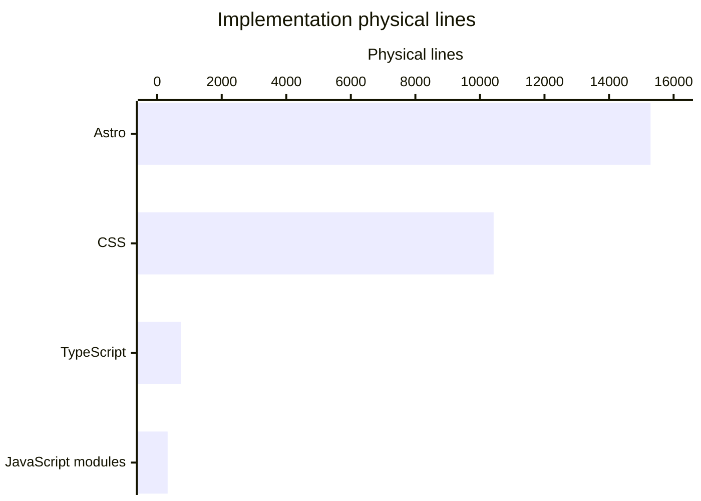

# By the numbers

Data collected on 2026-10-23.

This snapshot measures the website, not the installed Mythic apps. All counts use tracked blobs and commits reachable from `origin/main` at `5398f0ee162260a0106399164970cdfa4c155386`; untracked wiki output and unmerged branches are excluded.

See [Lore](lore.md) for the dated history and [Cleanup opportunities](cleanup-opportunities.md) for interpretation of current hotspots. These are repository measurements, not production traffic or test-coverage results.

## Size

The repository has **558 tracked files**. The following categories are disjoint and sum to that total.

| Category | Files | Physical lines | Exact scope |
| --- | ---: | ---: | --- |
| Implementation | 131 | 26,770 | `.astro`, `.ts`, `.mjs`, `.js`, `.css` under `src/` or `tools/`, plus all CSS under `public/`; excludes tests and selected configuration below |
| Tests | 4 | 220 | `src/**/*.test.ts` |
| Selected configuration | 18 | 1,242 | Explicit inventory below, assigned before implementation |
| Collection Markdown | 100 | 7,925 | `src/content/**/*.md`, including two templates |
| Other Markdown | 103 | 16,195 | All other tracked `.md`, including repository docs, agent skills, and `public/discord-guides/` |
| Other tracked files | 202 | Not counted | Assets, downloads/data, lockfile, shell/Python helpers, HTML, dotfiles, and other formats |

Physical lines are Python `len(blob.decode("utf-8").splitlines())`, including blank lines, comments, frontmatter, and a final unterminated line. No semantic code-line or executable-statement claim is made. Astro files contain HTML, TypeScript, and sometimes CSS; their entire physical size is attributed to Astro.

### Implementation language census

| Language/file format | Files | Physical lines |
| --- | ---: | ---: |
| Astro | 73 | 15,286 |
| CSS | 44 | 10,424 |
| TypeScript | 11 | 736 |
| JavaScript modules (`.mjs`) | 3 | 324 |
| **Total implementation** | **131** | **26,770** |



Markdown, selected configuration, tests, and downloadable JSON are not hidden inside this chart. The site is one application, not a workspace monorepo.

### Configuration boundary

The 18-file inventory comprises:

- `astro.config.mjs`, `vitest.config.ts`, `tsconfig.json`, `package.json`, `wrangler.jsonc`, `netlify.toml`, and `frontmatter.json`.
- `.codex/config.toml`, `.conductor/settings.local.toml`, and `.cursor/hooks.json`.
- `.frontmatter/database/pinnedItemsDb.json` and `.frontmatter/database/taxonomyDb.json`.
- `.netlify/netlify.toml` and `.netlify/state.json`.
- `.github/workflows/droid-wiki-refresh.yml`, `.github/workflows/factory-mentions.yml`, `.github/workflows/factory-review.yml`, and `.github/workflows/factory-triage.yml`.

This is deliberately a selected configuration count, not every file that can configure a tool. `src/content.config.ts` remains implementation because it defines application content schemas; `src/env.d.ts` is also implementation. `package-lock.json`, `.npmrc`, `.env.example`, and `.nvmrc` fall in other tracked files. Registry/environment contents were not inspected for these measurements.

## Activity

There are **319 commits** reachable from the snapshot, starting on **2025-08-23**. Activity counts include merge commits and commits on branches subsequently merged into main, counted once by hash. Dates use each commit's committer-local `%cs` date.

| Month | Commits |
| --- | ---: |
| 2026-05 | 18 |
| 2026-06 | 5 |
| 2026-07 | 3 |
| 2026-08 | 0 |
| 2026-09 | 0 |
| 2026-10 through 2026-10-23 | 30 |

| Week beginning Monday | Commits |
| --- | ---: |
| 2026-09-28 | 0 |
| 2026-10-05 | 3 |
| 2026-10-12 | 22 |
| 2026-10-19 through 2026-10-23 | 5 |

Zero recorded commits does not establish that no work happened elsewhere.

### Last 90 days

The inclusive window **2026-07-26 to 2026-10-23** contains 30 commits, including 22 non-merge commits. Churn sums added plus deleted text lines from each non-merge commit against its parent, with rename detection disabled. Merge diffs and binary files are excluded to avoid double counting branch changes and pretending image bytes are text lines.

| Directory bucket | Added | Deleted | Churn |
| --- | ---: | ---: | ---: |
| Root-level files | 3,890 | 4,490 | 8,380 |
| `docs/verification/` | 4,642 | 0 | 4,642 |
| `src/content/` | 966 | 523 | 1,489 |
| `src/components/` | 572 | 113 | 685 |
| `.agents/skills/` | 656 | 0 | 656 |
| `src/pages/` | 171 | 470 | 641 |
| `.github/workflows/` | 564 | 0 | 564 |
| `public/downloads/` | 13 | 19 | 32 |

Buckets group the first two path segments, with root-level files grouped together. This table ranks churn, not defect risk or engineering effort.

| File | Churn | Non-merge touches |
| --- | ---: | ---: |
| `package-lock.json` | 8,275 | 1 |
| `docs/verification/astro-7.4/responsive-image-metrics.json` | 4,598 | 1 |
| `src/components/legal/PrivacyArticle.astro` | 374 | 6 |
| `.agents/skills/astro-rules/SKILL.md` | 303 | 1 |
| `src/pages/privacy.astro` | 216 | 3 |
| `.github/workflows/factory-triage.yml` | 173 | 1 |
| `src/pages/pt/privacy.astro` | 170 | 5 |
| `src/components/legal/TermsArticle.astro` | 161 | 1 |

Lockfile regeneration and recorded image metrics dominate text churn. Legal extraction also produces deletions in route files and additions in shared components. These are not independent measures of newly implemented behavior.

## Bot-attributed commits

**77 of 319 commits, or 24.14%, have explicit bot authorship or a bot `Co-authored-by` trailer.** One commit matches the author rule and 76 match the trailer rule; there is no overlap in this snapshot.

The scan checks author name/email and only lines beginning `Co-authored-by:` in full commit messages. It recognizes `[bot]` or token-delimited agent identities `factory-droid`, `dependabot`, `github-actions`, `copilot`, `claude`, `devin`, `cursor`, and `codex`, case-insensitively. Human co-authors are not counted merely because a co-author trailer exists. A mention of an AI tool elsewhere in a message is not counted.

The denominator is every unique commit reachable from the snapshot, including merges, not just source-changing or recent commits. This is a **lower bound on recorded AI/bot attribution**, not a reliable percentage of AI-written code. Inline assistance and missing trailers leave no evidence; automation bots also do work that is not AI coding.

## Complexity

### Average implementation file size

These rows partition the same 131 implementation files used by the language chart. Nested directories are rolled up; tests, Markdown, and selected configuration are excluded.

| Directory or root file | Files | Total physical lines | Mean lines/file |
| --- | ---: | ---: | ---: |
| `src/components/` | 36 | 4,897 | 136.0 |
| `src/pages/` | 36 | 10,222 | 283.9 |
| `src/layouts/` | 2 | 192 | 96.0 |
| `src/lib/` | 5 | 300 | 60.0 |
| `src/i18n/` | 2 | 265 | 132.5 |
| `src/integrations/` | 2 | 151 | 75.5 |
| `src/content.config.ts` | 1 | 121 | 121.0 |
| `src/env.d.ts` | 1 | 1 | 1.0 |
| `public/styles/` | 34 | 5,978 | 175.8 |
| `public/v2/` | 9 | 4,409 | 489.9 |
| `public/global.css` | 1 | 37 | 37.0 |
| `tools/` | 2 | 197 | 98.5 |

### Local import depth

A regex-based graph over the **85 non-test source modules under `src/`** finds **189 unique local directed edges**. It recognizes literal relative `from`, side-effect `import`, and dynamic `import()` paths, resolving exact files, `.ts`/`.mjs`/`.js`/`.astro` suffixes, and matching `index` files. Imports of assets, packages, virtual Astro modules, computed paths, and CSS are outside this graph.

The longest detected simple chain has **7 files and 6 edges**:

1. `src/pages/apps.astro`
2. `src/components/pages/AppsPage.astro`
3. `src/layouts/BaseLayout.astro`
4. `src/components/layout/Footer.astro`
5. `src/components/layout/LanguageFab.astro`
6. `src/i18n/utils.ts`
7. `src/i18n/ui.ts`

Depth-first traversal starts at every node and stops at repeated nodes. No cycle was detected in this heuristic graph. That is not a compiler-verified proof of acyclicity; regex scanning can miss syntax or match imports in comments. This chain describes module dependencies, not synchronous browser calls.

### Export surface

The same source graph contains **39 syntactic export declarations** across 19 files. There is no package API boundary, so grouping is by directory.

| Directory or file | Export declarations | Files with exports |
| --- | ---: | ---: |
| `src/lib/` | 20 | 5 |
| `src/pages/` | 9 | 9 |
| `src/i18n/` | 6 | 2 |
| `src/integrations/` | 3 | 2 |
| `src/content.config.ts` | 1 | 1 |

This is a line-anchored syntax heuristic for exported functions, variables, types, interfaces, classes, enums, default exports, export lists, and star exports. An export list counts once, not once per symbol. It is not a compiler-resolved count of distinct public symbols; Astro's implicit component exports are excluded.

## Reproduction

Pin the reference before collecting results so later branch changes cannot alter the denominator:

```sh
REF=5398f0ee162260a0106399164970cdfa4c155386
git ls-tree -r --name-only "$REF"
git log "$REF" --format='%H %cs'
git log "$REF" --format='%H%x1f%an%x1f%ae%x1f%B%x1e'
git log "$REF" --follow --no-merges --format='%h %cs %s' -- src/components/layout/Header.astro
```

For file sizes, apply the disjoint scope rules above to the tree inventory and count lines from each selected `git show "$REF:$path"` blob. Do not dump registry or environment files. For activity, filter the complete commit list by the stated date boundaries rather than relying on history traversal pruning. For each qualifying non-merge hash, aggregate `git show --format= --numstat --no-renames HASH`, ignoring rows with `-` binary counts. Group full paths for file churn and the first two path segments for directory churn.

No dependency installation, application build, test run, or coverage measurement was performed for this snapshot.
