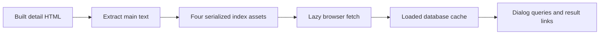

# Search

Active contributors: Jason

Search combines a sitewide full-text dialog with simpler page-local browsing controls. Only the dialog uses build-generated Orama databases; the Resources dropdown and Blog category buttons filter rendered elements.

## Index and query boundaries

`src/integrations/orama-search.mjs` runs at `astro:build:done`, after HTML exists. It matches emitted page paths, reads each page's HTML, extracts title, H1 and selected content, and serializes an Orama database. It tries directory-style HTML first and a flat HTML fallback. Missing matches and unreadable pages produce warnings rather than a search service.

`astro.config.mjs` selects `main` content and configures these independent databases:

| Database | Included route family | Important exclusion |
| --- | --- | --- |
| resources | `/resources/<detail>` | Resources landing page |
| blog | `/blog/<detail>` | Paths beginning with category or index |
| resources_pt | `/pt/resources/<detail>` | Portuguese landing page |
| blog_pt | `/pt/blog/<detail>` | Paths beginning with index |

These are regular-expression rules, not collection queries. Changing route conventions requires reviewing the matchers. No `/v2/` paths match. The configuration does not set Orama's optional `language` setting, so Portuguese route scoping should not be confused with an explicitly configured Portuguese analyzer.

## Browser behavior

`src/integrations/orama-search-client.ts` fetches `/assets/oramaDB_<name>.json`, loads it, and caches the loaded database by name. It caches completed databases, not in-flight requests. Query text stays in browser-side Orama calls; there is no query API.

`src/components/search/SearchOverlay.astro` opens a native dialog with Cmd/Ctrl+K or `/`, except that slash avoids editable fields. The production header does not render the existing trigger component. First opening starts loading the locale's resource and blog indexes. Input is debounced for 150 ms, with up to five hits from each database. Blog routes put Blog results first; other routes put Resources first. Excerpts are truncated and highlights use DOM text nodes rather than interpolated result HTML. Escape uses native dialog behavior; backdrop clicks close it, and arrow keys move through result links.

## Key source files

| Abstraction or source | Modification entry point |
| --- | --- |
| `src/integrations/orama-search.mjs` | Extraction, document fields, serialization |
| `src/integrations/orama-search-client.ts` | Fetching and loaded-database cache |
| `src/components/search/SearchOverlay.astro` | Shortcuts, grouping, loading states |
| `src/pages/resources/index.astro` | English title/summary/category substring filtering |
| `src/pages/pt/resources/index.astro` | Portuguese dropdown and status copy |
| `src/pages/blog/index.astro` | Category buttons and URL query state |
| `src/pages/pt/blog/index.astro` | Portuguese category filtering |

## Development and verification

Indexes are generated only by a production build. A fresh dev server cannot regenerate them. The client throws for missing assets; the dialog catches loading failures, logs them, and can continue displaying its loading message. Do not mistake this for an empty search result.

The Resources dropdown works independently of those assets. Its slash shortcut coexists with the dialog shortcut, so verify their interaction when changing keyboard behavior. See [content publishing](resources-and-blog.md) and [localization](localization.md).

Measured scope comprises the seven implementation files in the table, `astro.config.mjs`, and `src/components/search/SearchTrigger.astro`: **9 files, 0 test files**, and **1 unique human author** in `origin/main` history for those paths. Counts exclude generated indexes and content entries; no checks were executed for this documentation.
