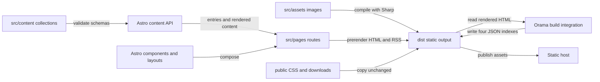
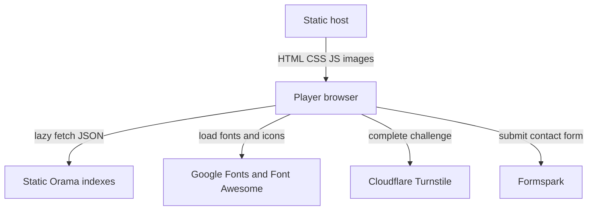

# Architecture

The website renders pages at build time and serves static files. Browser scripts add menus, carousels, search, and contact-form behavior. The Cloudflare adapter does not make this an application backend.

## Build flow

`src/content.config.ts` owns the collection schemas. Dynamic filenames such as `src/pages/resources/[slug].astro` still use `getStaticPaths()` to enumerate pages during the build. `src/pages/rss.xml.ts` produces an English XML feed.

`src/integrations/orama-search.mjs` runs in `astro:build:done`. It reads rendered HTML and writes browser-loadable indexes. This explains why search needs built artifacts rather than a search server.

## Browser boundaries

`src/layouts/BaseLayout.astro` supplies production metadata, header, footer, and the search dialog. `src/components/layout/Header.astro` owns navigation interactions. `src/pages/support.astro` and `src/pages/pt/support.astro` submit contact data directly to Formspark. See [Security](../security.md) for that trust boundary.

The website does not implement the journal storage, app telemetry, purchases, or dice evaluation described in its public guides and legal copy.

## Source languages

| Implementation language | Physical lines | Role |
| --- | ---: | --- |
| Astro | 15,286 | Route templates, layouts, and components under `src/pages/`, `src/layouts/`, and `src/components/` |
| CSS | 10,424 | Production and preview styles under `public/styles/` and `public/v2/` |
| TypeScript | 736 | Locale helpers, carousel state, collection schemas, and browser search |
| JavaScript modules | 324 | Search integration and utilities under `src/integrations/` and `tools/` |

This 2026-10-23 snapshot counts tracked implementation files, excluding tests and selected configuration files. Markdown content is counted separately. See [By the numbers](../by-the-numbers.md) for the exact scope and measurement caveats.

## Separate design surfaces

`src/layouts/V2RefinedLayout.astro` and `src/components/v2/refined/` form the `/v2/` preview shell. It defaults to `noindex`, and `astro.config.mjs` excludes preview URLs from the sitemap. It shares content collections with production, but not the production layout. See [Redesign preview](../systems/redesign-preview.md).

There are no workspace packages, database models, authentication service, or server job runner in the surveyed source. [Features](../features/index.md) and [Systems](../systems/index.md) are the useful entry points.
