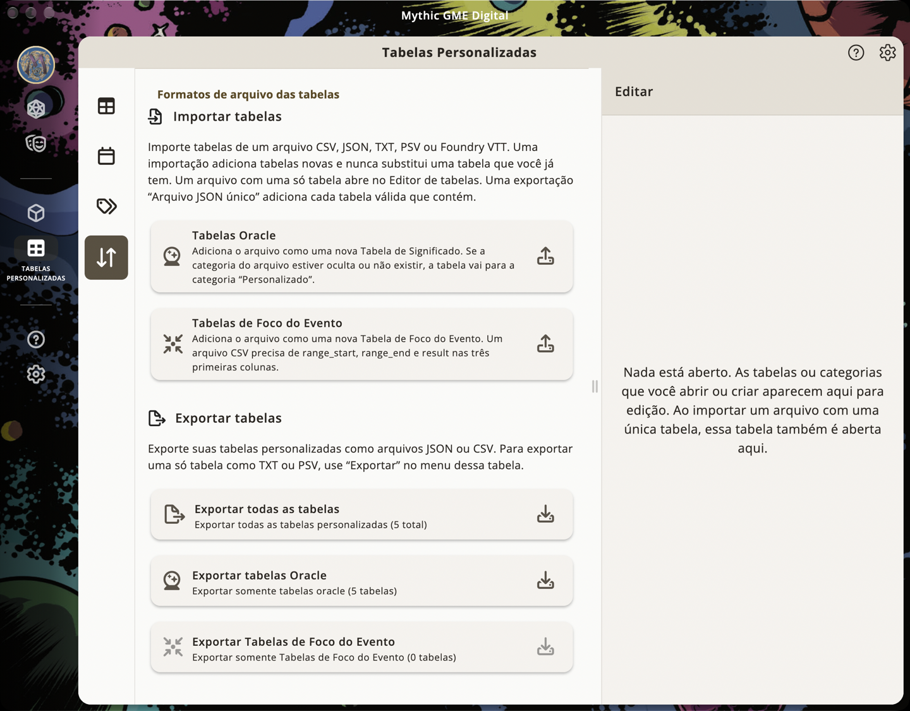
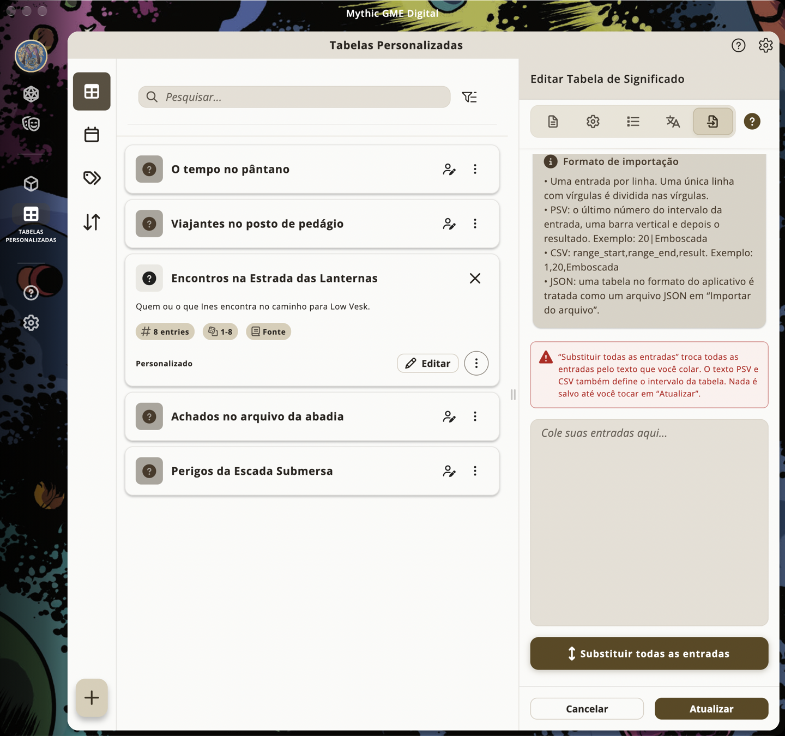

> Este guia descreve o Mythic GME 1.7.0 e posteriores.

Você pode trazer suas próprias tabelas para o Mythic GME a partir de arquivos CSV, TXT, PSV, JSON ou Foundry VTT JSON, e exportar suas tabelas para fazer backup ou compartilhar com outros jogadores.

## Onde importar e exportar

Abra **Tabelas Personalizadas** direto no app. A importação e a exportação ficam lá, não em **Configurações**.

- Para importar uma tabela nova, abra a aba **Arquivos** em Tabelas Personalizadas. No computador e no tablet, é o quarto ícone da barra lateral esquerda (dica **Importação/Exportação**). No celular, é a aba **Arquivos**, a quarta na barra de abas inferior.
- Para compartilhar ou fazer backup de tabelas, exporte uma tabela pelo menu dela ou use uma opção de exportação na aba **Arquivos** e escolha **Arquivo JSON único**. Você pode importar qualquer um desses arquivos pela aba **Arquivos**. Se exportar um arquivo ZIP, descompacte-o primeiro e importe os arquivos um de cada vez.

> ### Como desbloquear Tabelas Personalizadas
>
> - Na Apple App Store, no Google Play e na Amazon, Tabelas Personalizadas faz parte do desbloqueio único de Recursos Expandidos.
> - Na Microsoft Store e no itch.io, Tabelas Personalizadas vem incluído no Mythic GME Digital.

## Importar uma tabela nova de um arquivo

Use este fluxo para adicionar uma tabela personalizada nova a partir de CSV, TXT, PSV, JSON ou Foundry VTT JSON.

1. Abra **Tabelas Personalizadas**.
2. Abra a aba **Arquivos**.
3. Escolha **Tabelas Oracle** para uma Tabela de Significado, ou **Tabelas de Foco do Evento** para uma tabela de Foco de Evento.
4. Selecione um arquivo `.csv`, `.txt`, `.psv` ou `.json`.
5. Revise a tabela. O app salva a tabela importada e a abre direto no editor de tabelas.

A aba **Arquivos** importa apenas arquivos e não tem caixa de colagem para texto bruto. Para colar texto bruto em uma tabela, use o fluxo do editor de tabelas abaixo.

## Substituir entradas dentro do editor de tabelas

Ao editar uma tabela existente, a aba **Importação** do editor de tabelas oferece duas formas de trazer entradas:

- **Substituir todas as entradas.** Cole texto TXT, PSV ou CSV na caixa e escolha **Substituir todas as entradas**. Você também pode colar uma tabela inteira no formato JSON do app, que será tratada como um arquivo JSON.
- **Importar do arquivo.** Escolha um arquivo de tabela `.json`, `.csv`, `.txt` ou `.psv`.

Um arquivo JSON pode ser mesclado quando o ID da tabela corresponde à tabela que você está editando. Se os IDs não coincidirem, escolha **Substituir tudo** para sobrescrever a tabela. Salve suas alterações antes de importar um arquivo JSON aqui, porque tanto a mesclagem quanto **Substituir tudo** partem da tabela salva e descartam edições não salvas.

Arquivos CSV, TXT e PSV substituem as entradas atuais no editor. Essas mudanças ficam preparadas até você escolher **Criar** ou **Atualizar**.

Use essa caixa de colagem para substituir entradas em uma tabela que você já tem aberta. Esse não é o fluxo para importar uma tabela nova.

## Regras rápidas de formato

- Salve os arquivos com codificação UTF-8. Quebras de linha CRLF e LF funcionam bem.
- Os tipos de tabela válidos são `meaning-table` e `event-focus`.
- Suas entradas precisam cobrir todo o intervalo da tabela sem lacunas nem sobreposições. Os modelos iniciais começam em 1.
- CSV ponderado funciona apenas para Tabelas de Significado. Use intervalos explícitos para tabelas de Foco de Evento.
- Escolha o formato que combina com a sua tabela:
  - **CSV.** Tabelas por intervalo usam `range_start`, `range_end` e `result`. Tabelas de Significado também podem usar `result` e `weight`.
  - **TXT.** Uma entrada por linha, com uma linha `table_type` opcional.
  - **PSV.** Linhas `endpoint|result` cujas extremidades montam intervalos a partir de 1.
  - **JSON v3.** O formato mais completo, mantendo traduções, tags e vínculos. Na importação, o app ainda marca a tabela como sua, pode alterar o ID ou a categoria e descarta campos que não reconhece.

## Formato CSV

Arquivos CSV por intervalo precisam começar com `range_start`, `range_end` e `result` como as três primeiras colunas. Arquivos CSV ponderados de Tabela de Significado usam `result` e `weight`.

As colunas opcionais incluem `description`, `tags` (separadas por ponto e vírgula), `entryRollOn`, `table_description` e `table_type`. Arquivos CSV por intervalo de Tabela de Significado também aceitam `id`.

Considere estes pontos ao montar um arquivo CSV:

- Os nomes de cabeçalho não diferenciam maiúsculas de minúsculas.
- Se você incluir `table_type`, coloque o valor apenas na primeira linha de dados.
- Na caixa de colagem do editor, cole o CSV com a linha de cabeçalho ou em linhas que comecem com dois números seguidos de um resultado.

### Amostras em CSV

- [Modelo de Significado (CSV)](/downloads/meaning_table_template.csv)
- [Exemplo de Significado (CSV)](/downloads/meaning_table_example.csv)
- [Modelo de Significado Ponderado (CSV)](/downloads/meaning_table_weighted_template.csv)
- [Modelo de Foco de Evento (CSV)](/downloads/event_focus_template.csv)
- [Exemplo de Foco de Evento (CSV)](/downloads/event_focus_example.csv)

## Formato TXT

O formato TXT coloca uma entrada por linha e funciona bem para listas curtas.

- Uma linha opcional `table_type: meaning-table` ou `table_type: event-focus` pode aparecer na primeira ou na última linha não vazia.
- A caixa de colagem do editor também aceita listas curtas separadas por vírgula, como `Self, Allies, Foes`.

### Amostras em TXT

- [Modelo de Significado (TXT)](/downloads/meaning_table_template.txt)
- [Modelo de Foco de Evento (TXT)](/downloads/event_focus_template.txt)

## Formato PSV

O formato PSV usa extremidades separadas por barra vertical (pipe).

- Escreva cada linha como `endpoint|result`, ou `endpoint|result|description` quando quiser incluir uma descrição na entrada.
- Mantenha as extremidades únicas e em ordem crescente para facilitar a leitura. O primeiro intervalo começa em 1 e a maior extremidade vira `rangeEnd`.
- Uma linha opcional `table_type` pode aparecer no início ou no fim do arquivo.

### Amostras em PSV

- [Modelo de Significado (PSV)](/downloads/meaning_table_template.psv)
- [Modelo de Foco de Evento (PSV)](/downloads/event_focus_template.psv)

## Formato JSON

Use JSON quando quiser mover uma tabela completa entre instalações ou compartilhar uma tabela pronta para o app com outra pessoa. O formato JSON preserva traduções, tags e vínculos com outras tabelas. Se você estiver escrevendo uma tabela simples à mão, CSV, TXT ou PSV costuma ser mais rápido.

Um arquivo JSON pode definir `tableType` como `meaning-table` ou `event-focus`. Para uma tabela única, o cartão em que você toca na aba **Arquivos** define o tipo da tabela. Em uma exportação **Arquivo JSON único** com várias tabelas, cada tabela mantém seu próprio `tableType`. Uma tabela sem esse campo recebe o tipo do cartão, e uma tabela com `tableType` inválido é rejeitada.

### Amostras em JSON

- [Modelo de Significado (JSON)](/downloads/meaning_table_template.json)
- [Exemplo de Significado (JSON)](/downloads/meaning_table_sample.json)
- [Modelo de Foco de Evento (JSON)](/downloads/event_focus_template.json)
- [Exemplo de Foco de Evento (JSON)](/downloads/event_focus_sample.json)

## Foundry VTT JSON

Com o cartão **Tabelas Oracle**, o app trata um arquivo JSON como Foundry VTT quando ele tem um campo `name` e um array `results` cujos itens contêm `text`. Com o cartão **Tabelas de Foco do Evento**, o app trata um arquivo JSON como Foundry VTT quando o campo `name` contém `event`, `focus` ou `plot`, ou quando algum resultado contém `PC`, `NPC` ou `Thread`.

O app importa arquivos do Foundry VTT, mas não os exporta. Arrays `range` são usados quando estão presentes.

Veja como os campos do Foundry são mapeados na importação:

- `name` vira `displayName`.
- `description` vira `description`.
- `results[].text` vira `entries[].result`.
- `results[].range` vira `entries[].range` (por exemplo, `[min, max]`).
- Os metadados do Foundry são preservados em `data.foundry` quando você importa por **Tabelas Oracle**. Uma importação por **Tabelas de Foco do Evento** não preserva esses metadados.
- Importações de Foco de Evento sempre definem `categoryId` como `"event-focus"`.

### Amostras do Foundry VTT

- [Exemplo de Significado do Foundry (JSON)](/downloads/foundry_meaning_sample.json)
- [Exemplo de Foco de Evento do Foundry (JSON)](/downloads/foundry_event_focus_sample.json)

## Validação e solução de problemas

- Confira se suas entradas cobrem todo o intervalo da tabela sem lacunas nem sobreposições.
- Confira se os cabeçalhos das colunas estão escritos corretamente (maiúsculas e minúsculas não fazem diferença).
- Preencha `result` em todas as linhas. Um CSV por intervalo de Tabela de Significado importa um resultado em branco como entrada vazia, enquanto um CSV de Foco de Evento descarta essa linha.
- Se uma tabela única não puder ser lida ou importada, a aba **Arquivos** mostra um erro. Quando um arquivo contém várias tabelas, o app importa as que consegue e pula o restante, depois mostra quantas foram importadas do total e lista os nomes das que falharam. Ele pode não indicar qual linha ou valor causou o problema.

## Próximos passos

- Crie suas primeiras tabelas em [Começando com Tabelas Personalizadas](/pt/resources/getting-started-with-custom-tables-pt/).
- Organize categorias, ícones e tags em [Organizando Tabelas Personalizadas](/pt/resources/organizing-custom-tables-pt/).
- Encadeie rolagens entre tabelas e listas em [Vincular e aninhar tabelas](/pt/resources/linking-and-nesting-tables-pt/).
- Confira cada campo JSON em [Esquema de Tabela Personalizada](/pt/resources/custom-table-schema-pt/) e [Esquema de Categorias](/pt/resources/categories-schema-pt/).
