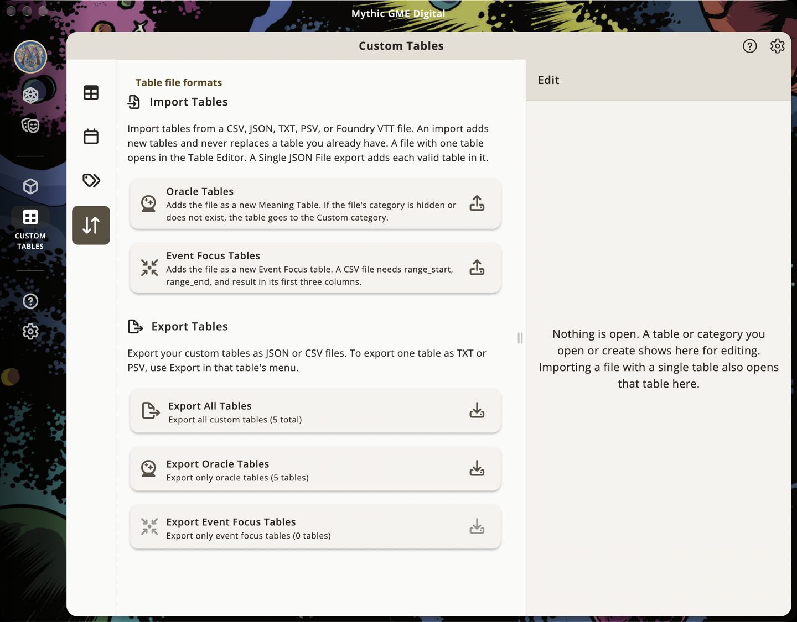
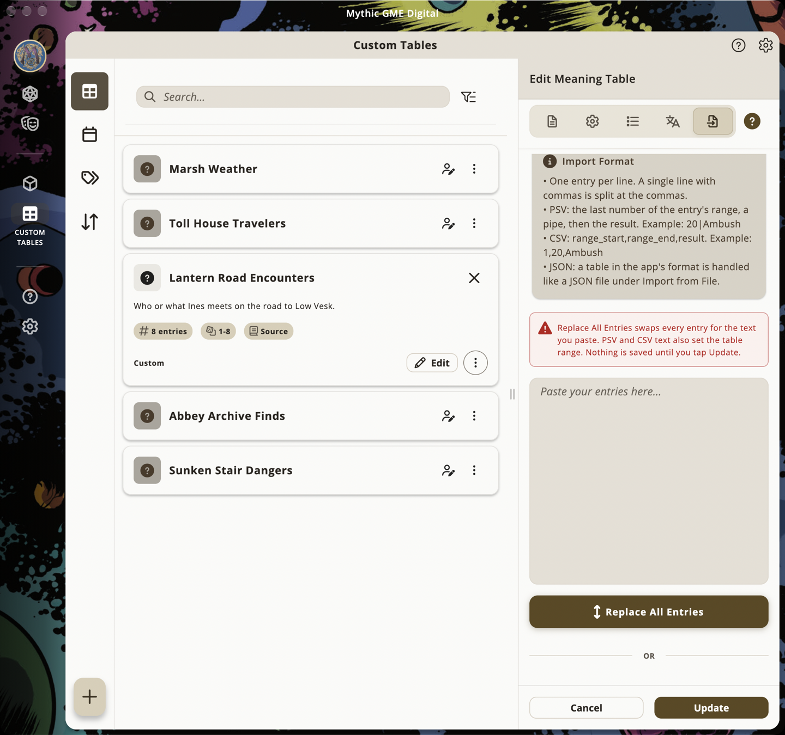

> This guide describes Mythic GME 1.7.0 and later.

## Where to import/export

- Open the Custom Tables feature in the app (not in Settings).
- To import a brand-new table, use the **Files** tab in Custom Tables.
- On desktop and tablet, it is the fourth icon in the left sidebar, with the tooltip Import/Export. On phones, it is the Files tab, fourth in the bottom tab bar.
- To share or back up tables, export one table from its menu, or use an export option on the Files tab and choose Single JSON File. You can import either file from the Files tab, but a ZIP export must be unzipped and its files imported one at a time.
- Unlocking note: on Google Play, Amazon, and the Apple App Store, Custom Tables requires an IAP; Itch.io and Microsoft Store include it with a higher‑priced purchase.

## Importing a new table from a file

Use this flow when you want to add a new custom table from CSV, TXT, PSV, JSON, or Foundry JSON.

1. Open **Custom Tables**.
2. Choose the **Files** tab.
3. Choose **Oracle Tables** for a meaning table, or **Event Focus Tables** for an event focus table.
4. Pick a `.csv`, `.txt`, `.psv`, or `.json` file.
5. The app saves the imported table and opens it in the table editor for review.

The Files tab imports files. It does not have a paste box for raw text. The paste box is in the existing-table editing flow below.

## Replacing entries inside the table editor

When you edit an existing table, the table editor's Import tab has two import paths:

- **Replace All Entries:** paste TXT, PSV, or CSV content into the text box, then choose Replace All Entries. You can also paste a whole table in the app's JSON format. It is handled like a JSON file.
- **Import from File:** choose a `.json`, `.csv`, `.txt`, or `.psv` table file.
- JSON files can merge when the imported table ID matches the table you are editing. If the IDs do not match, choose Replace All to overwrite the table. Save your changes before you import a JSON file here. A merge or Replace All starts from the saved table, so edits you have not saved are discarded.
- CSV, TXT, and PSV files replace the current entries in the editor. The change is staged until you choose Create or Update.

This paste box is for replacing entries in a table you are already editing. It is not the brand-new-table import flow.

## Quick rules (TL;DR)

- File encoding: UTF‑8 (CRLF or LF line endings are OK)
- Table types: `meaning-table` or `event-focus`
- Range coverage: Your entries must fully cover the table range without gaps/overlaps; the templates start at 1
- Formats:
  - CSV: ranged tables use `range_start, range_end, result`; meaning tables can also use `result, weight`
  - TXT: one entry per line (+ optional table_type line)
  - PSV: `endpoint|result` with endpoints that produce 1..N ranges
  - JSON v3: the most complete format, including translations, tags, and links. On import the app still marks the table as yours, can change its id or category, and drops fields it does not know.
- Weighted CSV: supported for meaning tables; use explicit ranges for event focus tables

## CSV format

Ranged CSV:
- The first three columns must be `range_start`, `range_end`, `result`

Weighted meaning-table CSV:
- Use `result`, `weight`

Optional columns:
- `description`, `tags` (semicolon‑separated), `entryRollOn`, `table_description`, `table_type`
- Ranged meaning-table CSV also accepts `id`

Notes
- Header names are case‑insensitive
- `table_type` is optional; if used, only the first data row should contain a value
- In the editor paste box, paste CSV with its header row, or as rows that start with two numbers and a result.
- If a single table cannot be read or imported, the Files tab shows an error. From a file that holds several tables, the app imports the tables it can and skips the others, then shows how many were imported out of the total and names the ones that were not. It may not say which row or value caused the problem.

Samples
- Meaning Template (CSV): [Download](/downloads/meaning_table_template.csv)
- Meaning Example (CSV): [Download](/downloads/meaning_table_example.csv)
- Meaning Weighted Template (CSV): [Download](/downloads/meaning_table_weighted_template.csv)
- Event Focus Template (CSV): [Download](/downloads/event_focus_template.csv)
- Event Focus Example (CSV): [Download](/downloads/event_focus_example.csv)

## TXT format (one per line)

- One entry per line. Simple and fast for short lists.
- Optional `table_type: meaning-table` (or `event-focus`) line may appear on the first or last non‑empty line.
- The editor paste box also accepts short comma-separated lists such as `Self, Allies, Foes`.

Samples
- Meaning Template (TXT): [Download](/downloads/meaning_table_template.txt)
- Event Focus Template (TXT): [Download](/downloads/event_focus_template.txt)

## PSV format (pipe‑separated endpoints)

- Each line: `endpoint|result`; optional descriptions use `endpoint|result|description`
- Keep endpoints unique and ascending for readability; first range starts at 1 and the highest endpoint becomes the table’s rangeEnd
- Optional table_type line may appear at the beginning or end

Samples
- Meaning Template (PSV): [Download](/downloads/meaning_table_template.psv)
- Event Focus Template (PSV): [Download](/downloads/event_focus_template.psv)

## JSON format

- Use JSON when you want to move a complete table between app installs or share an app-ready table with someone else.
- JSON keeps more of the table than the short text formats, including translations, tags, and links to other tables.
- A JSON file can set `tableType` to `meaning-table` or `event-focus`. For a single table, the card you tap on the Files tab sets the table type. In a Single JSON File export that holds several tables, each table keeps its own tableType, a table without one takes the card's type, and a table with an invalid tableType is not accepted.
- For writing a simple table by hand, CSV, TXT, or PSV is usually easier.

Samples
- Meaning Template (JSON): [Download](/downloads/meaning_table_template.json)
- Meaning Sample (JSON): [Download](/downloads/meaning_table_sample.json)
- Event Focus Template (JSON): [Download](/downloads/event_focus_template.json)
- Event Focus Sample (JSON): [Download](/downloads/event_focus_sample.json)

## Foundry VTT JSON (auto‑mapping)

With the Oracle Tables card, a JSON file is treated as Foundry VTT when it has a name and a results array whose entries contain text. With the Event Focus Tables card, it is treated as Foundry VTT when its name contains event, focus, or plot, or a result contains PC, NPC, or Thread. The app imports Foundry files but does not export them. `range` arrays are used when present.

Mapping highlights
- `name` → `displayName`
- `description` → `description`
- `results[].text` → `entries[].result`
- `results[].range` → `entries[].range` (e.g., `[min, max]`)
- Foundry metadata is preserved under data.foundry when you import through Oracle Tables. An Event Focus Tables import does not keep it.
- Event Focus imports enforce `categoryId = "event-focus"`

Samples
- Foundry Meaning Sample (JSON): [Download](/downloads/foundry_meaning_sample.json)
- Foundry Event Focus Sample (JSON): [Download](/downloads/foundry_event_focus_sample.json)

## Validation & troubleshooting

- Range coverage: full table range with no gaps or overlaps
- Headers spelled correctly (case‑insensitive)
- Fill in result on every row. A ranged Meaning Table CSV imports a blank result as an empty entry, and an Event Focus CSV drops the row.
- If a single table cannot be read or imported, the Files tab shows an error. From a file that holds several tables, the app imports the tables it can and skips the others, then shows how many were imported out of the total and names the ones that were not. It may not say which row or value caused the problem.

## Next steps

- Get oriented and create your first tables: see “Getting Started with Custom Tables”
- Organize categories, icons, and links: see “Organizing Custom Tables”
- JSON field reference: see “Custom Table Schema” and “Categories Schema”
