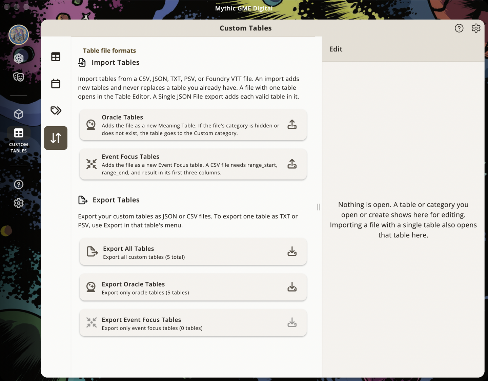
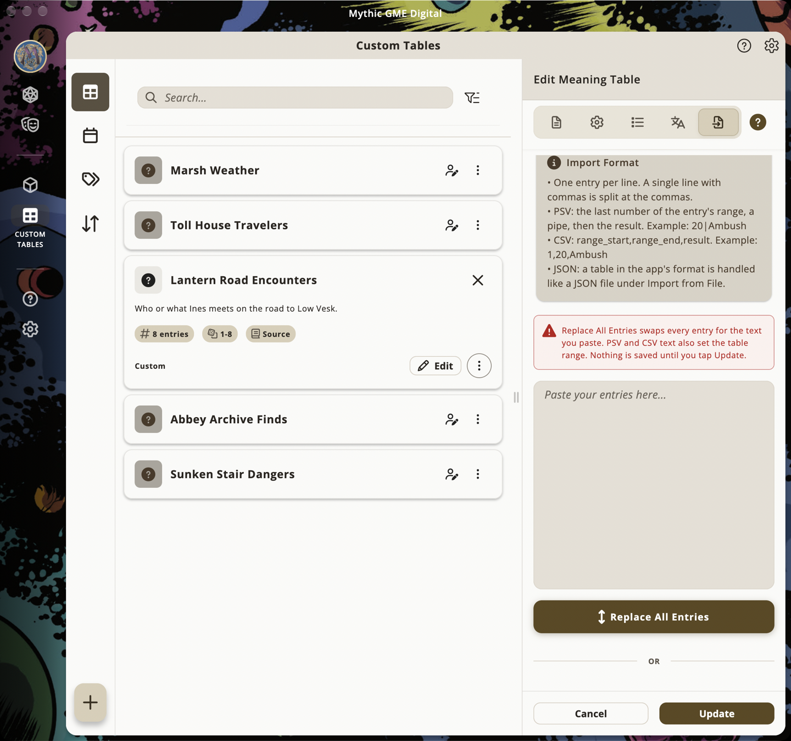

> This guide describes Mythic GME 1.7.0 and later.

You can bring your own tables into Mythic GME from CSV, TXT, PSV, JSON, or Foundry VTT JSON files, and export your tables to back them up or share them with other players.

## Where to import and export

Open **Custom Tables** directly in the app. Import and export live there, not in **Settings**.

- To import a brand-new table, open the **Files** tab in Custom Tables. On desktop and tablet, it is the fourth icon in the left sidebar (tooltip **Import/Export**). On phones, it is the **Files** tab, fourth in the bottom tab bar.
- To share or back up tables, export a single table from its menu, or use an export option on the **Files** tab and choose **Single JSON File**. You can import either file from the **Files** tab. If you export a ZIP archive, unzip it first and import the files one at a time.

> ### How to unlock Custom Tables
>
> - On the Apple App Store, Google Play, and Amazon, Custom Tables is part of the one-time Expanded Features unlock.
> - On the Microsoft Store and itch.io, Custom Tables is included with Mythic GME Digital.

## Import a new table from a file

Use this flow to add a brand-new custom table from CSV, TXT, PSV, JSON, or Foundry VTT JSON.

1. Open **Custom Tables**.
2. Open the **Files** tab.
3. Choose **Oracle Tables** for a Meaning Table, or **Event Focus Tables** for an Event Focus table.
4. Pick a `.csv`, `.txt`, `.psv`, or `.json` file.
5. Review the table. The app saves the imported table and opens it in the table editor right away.

The **Files** tab imports files only and has no paste box for raw text. To paste raw text into a table, use the table editor flow below.

## Replace entries inside the table editor

When you edit an existing table, the table editor's **Import** tab gives you two ways to bring in entries:

- **Replace All Entries.** Paste TXT, PSV, or CSV text into the box, then choose **Replace All Entries**. You can also paste a full table in the app's JSON format, and the app treats it like a JSON file.
- **Import from File.** Choose a `.json`, `.csv`, `.txt`, or `.psv` table file.

A JSON file can merge when its table ID matches the table you are editing. If the IDs do not match, choose **Replace All** to overwrite the table. Save your changes before you import a JSON file here, because both merge and **Replace All** start from the saved table and discard unsaved edits.

CSV, TXT, and PSV files replace the current entries in the editor. Those changes stay staged until you choose **Create** or **Update**.

Use this paste box to replace entries in a table you already have open. It is not the flow for importing a brand-new table.

## Quick format rules

- Save files in UTF-8 encoding. Both CRLF and LF line endings work.
- Valid table types are `meaning-table` and `event-focus`.
- Your entries must cover the full table range with no gaps or overlaps. The starter templates start at 1.
- Weighted CSV works for Meaning Tables only. Use explicit ranges for Event Focus tables.
- Pick the format that fits your table:
  - **CSV.** Ranged tables use `range_start`, `range_end`, and `result`. Meaning Tables can also use `result` and `weight`.
  - **TXT.** One entry per line, with an optional `table_type` line.
  - **PSV.** `endpoint|result` lines whose endpoints build ranges starting at 1.
  - **JSON v3.** The most complete format, keeping translations, tags, and links. On import, the app still marks the table as yours, can change its ID or category, and drops fields it does not recognize.

## CSV format

Ranged CSV files must start with `range_start`, `range_end`, and `result` as the first three columns. Weighted Meaning Table CSV files use `result` and `weight`.

Optional columns include `description`, `tags` (semicolon-separated), `entryRollOn`, `table_description`, and `table_type`. Ranged Meaning Table CSV files also accept `id`.

Keep these details in mind when building a CSV file:

- Header names are case-insensitive.
- If you include `table_type`, put the value in the first data row only.
- In the editor paste box, paste CSV with its header row, or as rows that start with two numbers followed by a result.

### CSV samples

- [Meaning Template (CSV)](/downloads/meaning_table_template.csv)
- [Meaning Example (CSV)](/downloads/meaning_table_example.csv)
- [Meaning Weighted Template (CSV)](/downloads/meaning_table_weighted_template.csv)
- [Event Focus Template (CSV)](/downloads/event_focus_template.csv)
- [Event Focus Example (CSV)](/downloads/event_focus_example.csv)

## TXT format

TXT puts one entry per line, which works well for short lists.

- An optional `table_type: meaning-table` or `table_type: event-focus` line can appear on the first or last non-empty line.
- The editor paste box also accepts short comma-separated lists such as `Self, Allies, Foes`.

### TXT samples

- [Meaning Template (TXT)](/downloads/meaning_table_template.txt)
- [Event Focus Template (TXT)](/downloads/event_focus_template.txt)

## PSV format

PSV uses pipe-separated endpoints.

- Write each line as `endpoint|result`, or `endpoint|result|description` when you want an entry description.
- Keep endpoints unique and ascending so the file stays readable. The first range starts at 1, and the highest endpoint becomes `rangeEnd`.
- An optional `table_type` line can appear at the beginning or end of the file.

### PSV samples

- [Meaning Template (PSV)](/downloads/meaning_table_template.psv)
- [Event Focus Template (PSV)](/downloads/event_focus_template.psv)

## JSON format

Use JSON when you want to move a complete table between installs or share an app-ready table with someone else. JSON keeps translations, tags, and links to other tables. If you are writing a simple table by hand, CSV, TXT, or PSV is usually faster.

A JSON file can set `tableType` to `meaning-table` or `event-focus`. For a single table, the card you tap on the **Files** tab sets the table type. In a **Single JSON File** export that holds several tables, each table keeps its own `tableType`. A table without one takes the card's type, and a table with an invalid `tableType` is rejected.

### JSON samples

- [Meaning Template (JSON)](/downloads/meaning_table_template.json)
- [Meaning Sample (JSON)](/downloads/meaning_table_sample.json)
- [Event Focus Template (JSON)](/downloads/event_focus_template.json)
- [Event Focus Sample (JSON)](/downloads/event_focus_sample.json)

## Foundry VTT JSON

With the **Oracle Tables** card, the app treats a JSON file as Foundry VTT when it has a `name` and a `results` array whose entries contain `text`. With the **Event Focus Tables** card, the app treats a JSON file as Foundry VTT when its `name` contains `event`, `focus`, or `plot`, or when a result contains `PC`, `NPC`, or `Thread`.

The app imports Foundry VTT files, though it does not export them. `range` arrays are used when present.

Here is how Foundry fields map on import:

- `name` maps to `displayName`.
- `description` maps to `description`.
- `results[].text` maps to `entries[].result`.
- `results[].range` maps to `entries[].range` (for example, `[min, max]`).
- Foundry metadata is preserved under `data.foundry` when you import through **Oracle Tables**. An **Event Focus Tables** import does not keep it.
- Event Focus imports always set `categoryId` to `"event-focus"`.

### Foundry VTT samples

- [Foundry Meaning Sample (JSON)](/downloads/foundry_meaning_sample.json)
- [Foundry Event Focus Sample (JSON)](/downloads/foundry_event_focus_sample.json)

## Validation and troubleshooting

- Check that your entries cover the full table range with no gaps or overlaps.
- Check that your column headers are spelled right (letter case does not matter).
- Fill in `result` on every row. A ranged Meaning Table CSV imports a blank result as an empty entry, while an Event Focus CSV drops that row.
- If a single table cannot be read or imported, the **Files** tab shows an error. When a file holds several tables, the app imports the tables it can and skips the rest, then shows how many were imported out of the total and names the ones that failed. It may not tell you which row or value caused the problem.

## Next steps

- Create your first tables in [Getting Started with Custom Tables](/resources/getting-started-with-custom-tables/).
- Organize categories, icons, and tags in [Organizing Custom Tables](/resources/organizing-custom-tables/).
- Chain rolls across tables and lists in [Linking & Nesting Tables](/resources/linking-and-nesting-tables/).
- Check every JSON field in [Custom Table Schema](/resources/custom-table-schema/) and [Categories Schema](/resources/categories-schema/).
